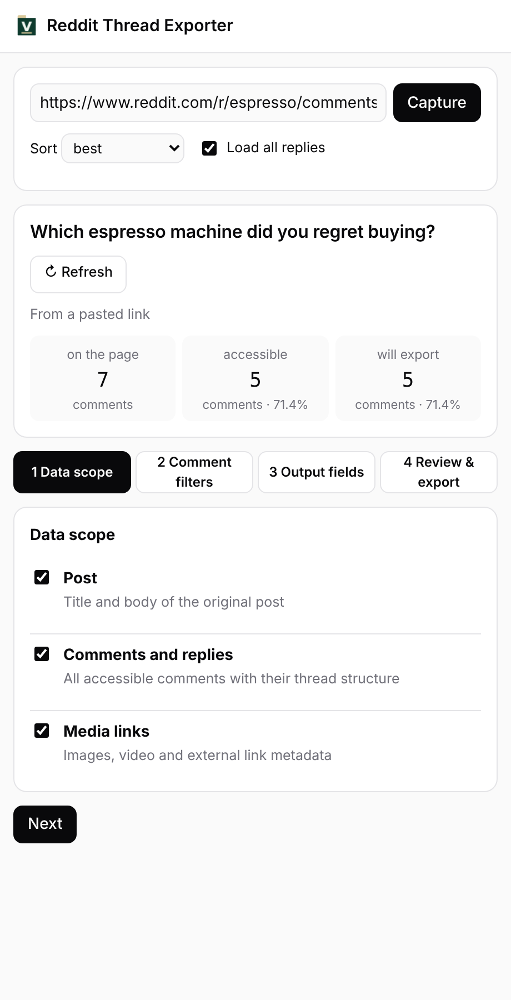

# Reddit Thread Exporter

A Chrome extension that exports a whole Reddit thread, including the replies hidden behind "load more comments", to clean Markdown or JSON. Free, no account, MIT licensed.

[中文说明](README.zh-CN.md)

<picture>
  <source media="(prefers-color-scheme: dark)" srcset="docs/panel-dark.png">
  
</picture>

## What it does

- Captures every comment and reply it can reach, with its place in the thread, score, date and permalink
- Expands "load more comments" automatically, and tells you how many replies Reddit would not return
- Filters: depth, minimum score, maximum count, deleted or removed comments, AutoModerator, link-only comments, original poster only
- Choose the output fields; your choices are remembered for the next thread
- Exports Markdown (for reading, notes or pasting into an AI tool) or JSON (for your own scripts), or copies Markdown to the clipboard

## Install

You don't need to run any commands to use it.

**Easiest: Chrome Web Store.** [Add Reddit Thread Exporter to Chrome](https://chromewebstore.google.com/detail/jhjdgidelbpfpcmekocnblmdjccfhkaa). It updates itself.

**Or from this repository** (for trying a change, or if you'd rather not use the store):

1. Click the green **Code** button above, then **Download ZIP**, and unzip it. (Or `git clone` the repository.)
2. In Chrome, open `chrome://extensions` and turn on **Developer mode** (top right).
3. Click **Load unpacked** and choose the unzipped folder (the one with `manifest.json` in it).
4. Click the puzzle icon in the toolbar and pin **Reddit Thread Exporter**.

## Use

1. Open a Reddit thread (a URL with `/comments/` in it), on www.reddit.com or old.reddit.com.
2. Click the extension icon. The side panel opens and captures the thread, loading the hidden replies; big threads take a little while.
3. The first time, walk through the four steps: what to include, which comments to keep, which fields, then review. Your choices are remembered, so next time it goes straight to export.
4. Click **Download Markdown**, **Download JSON** or **Copy Markdown**.

You can also paste a thread link into the box at the top and click **Capture**.

Works in Chrome 116 or later, and in other Chromium browsers with side panels (Edge, Brave). Installed this way it does not update itself: download the ZIP again, replace the folder, and click the reload icon on `chrome://extensions`.

If **Load unpacked** says "Manifest file is missing", you picked the outer folder: choose the folder that directly contains `manifest.json`.

## Privacy

The extension reads only the Reddit threads you open or paste, through Reddit's public JSON endpoints, from your own browser. It sends nothing anywhere else: there is no account, no server and no analytics. Exports are created in your browser and saved to your computer.

Permissions: `sidePanel` (the panel), `downloads` (saving files), `storage` (your remembered settings), and access to `www.reddit.com` and `old.reddit.com`.

## Develop

Only needed if you change the code. No build step and no dependencies: plain ES modules, so edit a file and click the reload icon on `chrome://extensions`. [Node.js](https://nodejs.org/) 18+ runs the tests.

```
npm test        # runs test/test.mjs against a synthetic thread
npm run pack    # builds dist/reddit-thread-exporter-<version>.zip for the Chrome Web Store
```

Code map: `src/capture.js` fetches a thread and its "more comments", `src/reddit.js` turns Reddit's response into comments and applies filters, `src/export.js` writes Markdown and JSON, `sidepanel.js` is the UI.

## About

Made by [Valtaris](https://valtaris.net/). Not affiliated with or endorsed by Reddit, Inc. Please respect Reddit's terms and the people whose comments you export.

Issues and pull requests are welcome.
