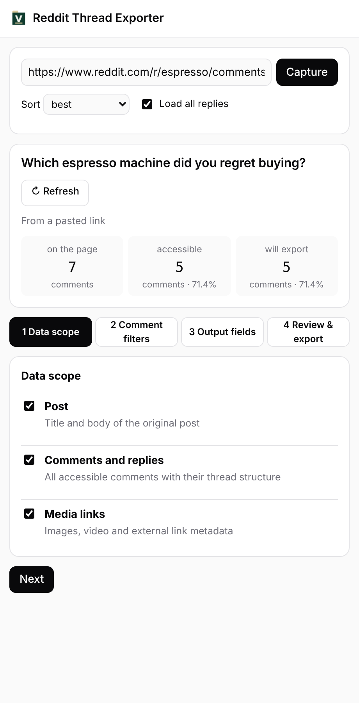

# Reddit Thread Exporter（Reddit 帖子导出）

Chrome 插件：把一整个 Reddit 帖子，连同藏在 "load more comments" 里的回复，导出成 Markdown 或 JSON。免费、不用注册，MIT 开源。

[English](README.md)

## 安装

使用它不需要运行任何命令。

**方式一：Chrome 应用商店（推荐，会自动更新）**
[点这里添加到 Chrome](https://chromewebstore.google.com/detail/jhjdgidelbpfpcmekocnblmdjccfhkaa)

**方式二：从本仓库安装**

1. 点页面上方绿色的 **Code** 按钮 → **Download ZIP**，下载后解压。（会用 git 的话也可以 `git clone`。）
2. 在 Chrome 地址栏打开 `chrome://extensions`，打开右上角的 **开发者模式**。
3. 点 **加载已解压的扩展程序**（Load unpacked），选择解压出来的文件夹（里面直接有 `manifest.json` 的那一层）。
4. 点工具栏的拼图图标，把 **Reddit Thread Exporter** 固定到工具栏。

需要 Chrome 116 或更新版本；Edge、Brave 等 Chromium 浏览器也能用。用这种方式安装不会自动更新：要升级时重新下载 ZIP、替换文件夹，再在 `chrome://extensions` 点一下刷新图标。

如果提示 "Manifest file is missing"（缺少清单文件），说明选错了文件夹，请选直接包含 `manifest.json` 的那一层。

## 使用

1. 打开一个 Reddit 帖子（网址里带 `/comments/`），www.reddit.com 或 old.reddit.com 都可以。
2. 点插件图标，右侧会打开面板并自动抓取帖子，包括隐藏的回复；评论多的帖子要等一会儿。
3. 第一次使用时按四步选择：导出范围、评论筛选、输出字段、检查。选择会被记住，以后直接导出。
4. 点 **下载 Markdown**、**下载 JSON** 或 **复制 Markdown**。

也可以把帖子链接粘贴到顶部的输入框，点 **抓取**。

## 隐私

插件只读取你打开或粘贴的 Reddit 帖子，在你自己的浏览器里通过 Reddit 公开的 JSON 接口读取。没有账号、没有服务器、没有统计，不会把任何数据发到别处。导出的文件在浏览器里生成，直接存到你的电脑。

## 关于

由 [Valtaris](https://valtaris.net/) 制作，与 Reddit, Inc. 无关联。导出时请遵守 Reddit 的条款，尊重发言者。欢迎提 Issue 和 Pull Request。
